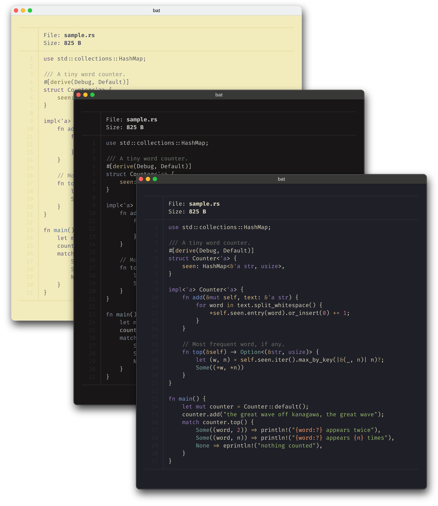
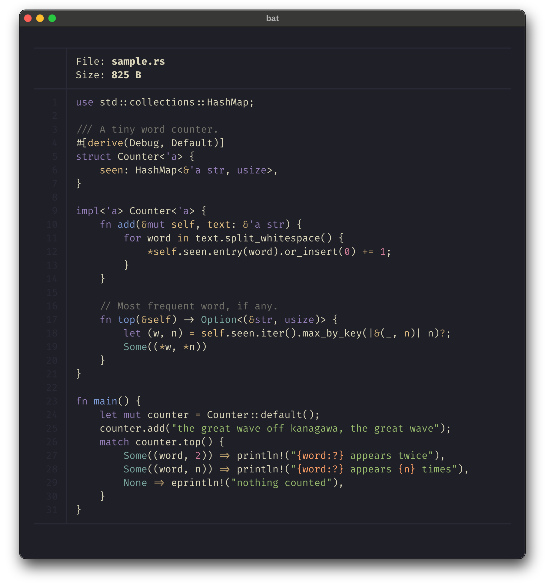
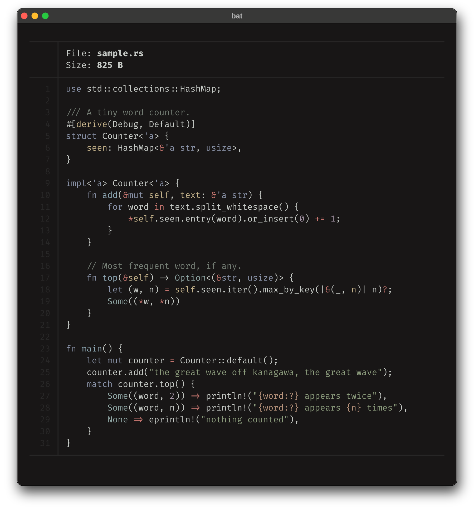
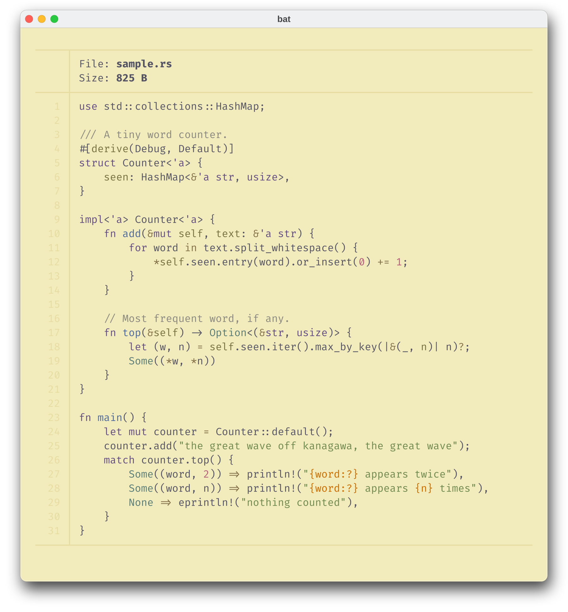

<h3>Kanagawa for <a href="https://github.com/sharkdp/bat">bat</a></h3>
<p>A community-maintained theme inspired by Hokusai's <em>The Great Wave off Kanagawa</em>.</p>
<p>Using the <a href="https://github.com/rebelot/kanagawa.nvim">Kanagawa palette</a> by <a href="https://github.com/rebelot">Tommaso Laurenzi (rebelot)</a>.</p>

<p>
  <a href="https://github.com/kanagawa-community/bat/stargazers">
    <picture>
      <source media="(prefers-color-scheme: dark)" srcset="https://img.shields.io/github/stars/kanagawa-community/bat?style=for-the-badge&amp;labelColor=1F1F28&amp;color=E6C384">
      <source media="(prefers-color-scheme: light)" srcset="https://img.shields.io/github/stars/kanagawa-community/bat?style=for-the-badge&amp;labelColor=F2ECBC&amp;color=77713F">
      
    </picture>
  </a>
  <a href="https://github.com/kanagawa-community/bat/releases/latest">
    <picture>
      <source media="(prefers-color-scheme: dark)" srcset="https://img.shields.io/github/v/release/kanagawa-community/bat?style=for-the-badge&amp;label=release&amp;labelColor=1F1F28&amp;color=7E9CD8">
      <source media="(prefers-color-scheme: light)" srcset="https://img.shields.io/github/v/release/kanagawa-community/bat?style=for-the-badge&amp;label=release&amp;labelColor=F2ECBC&amp;color=4D699B">
      
    </picture>
  </a>
  <a href="https://github.com/kanagawa-community/bat/issues">
    <picture>
      <source media="(prefers-color-scheme: dark)" srcset="https://img.shields.io/github/issues/kanagawa-community/bat?style=for-the-badge&amp;labelColor=1F1F28&amp;color=C34043">
      <source media="(prefers-color-scheme: light)" srcset="https://img.shields.io/github/issues/kanagawa-community/bat?style=for-the-badge&amp;labelColor=F2ECBC&amp;color=C84053">
      
    </picture>
  </a>
</p>

<br clear="both">
<br>

## Previews



<details>
<summary>🌊 Wave</summary>

</details>

<details>
<summary>🐉 Dragon</summary>

</details>

<details>
<summary>🪷 Lotus</summary>

</details>

## Requirements

- [bat](https://github.com/sharkdp/bat) 0.18 or later (custom themes need `bat cache --build`)

## Installation

Clone the repository and run the install script. It copies the themes into bat's
config directory and rebuilds bat's cache:

```sh
git clone https://github.com/kanagawa-community/bat
cd bat
./install.sh
```

`./install.sh` installs all three variants. Name the ones you want instead, for
example `./install.sh dragon lotus`. Run it again after `git pull` to update.
`./uninstall.sh` takes the same names and removes them.

Check that bat found them with `bat --list-themes | grep kanagawa`.

## Usage

```sh
bat --theme kanagawa-wave file.rs
```

Make a variant the default with `--theme=kanagawa-wave` in `bat --config-file`, or
with `export BAT_THEME=kanagawa-wave`. For Dragon or Lotus use `kanagawa-dragon`
or `kanagawa-lotus`.

To follow the terminal's light or dark mode, set both (needs bat 0.25 or later):

```sh
--theme-dark=kanagawa-wave
--theme-light=kanagawa-lotus
```

[delta](https://github.com/dandavison/delta) reads these themes too, as its
`syntax-theme`.

## Issues and contributions

Report bugs and request changes in this port's
[issue tracker](https://github.com/kanagawa-community/bat/issues). Contributions are welcome.

See [CONTRIBUTING.md](CONTRIBUTING.md) before opening a pull request.

## License

MIT. See [LICENSE](LICENSE).
